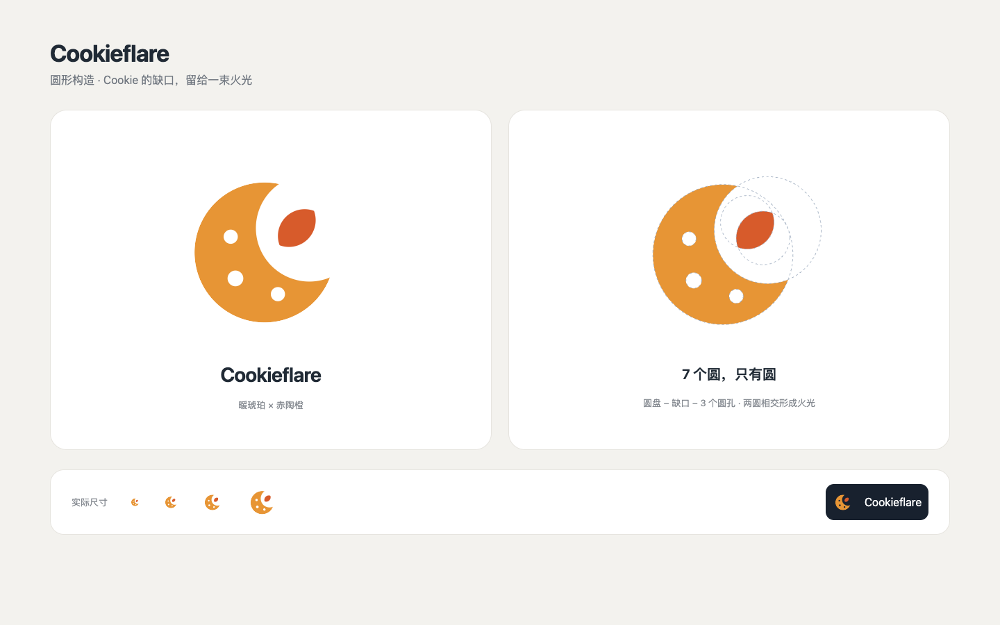

# Cookieflare 圆形标志

源文件为 [`frontend/favicon.svg`](../../frontend/favicon.svg)。所有可见轮廓由圆的相减或相交构成，不使用手绘路径、直线、椭圆或栅格图片。透明背景适配明暗主题；Nuxt UI 管理台、登录页和浏览器标签页共用同一份构建产物。

| 圆 | 圆心 | 半径 | 用途 |
| --- | --- | --- | --- |
| 主体 | 120, 132 | 89 | Cookie 圆盘 |
| 缺口 | 177, 101 | 68 | 从主体相减，形成 C 的开口 |
| 圆孔一 | 77, 112 | 9 | 从主体相减 |
| 圆孔二 | 83, 165 | 10 | 从主体相减 |
| 圆孔三 | 137, 185 | 9 | 从主体相减 |
| 火光一 | 151, 91 | 34 | 与火光二相交 |
| 火光二 | 171, 111 | 34 | 两圆相交形成有尖端的独立火光 |

画布为 256 × 256。主体使用 `#E79535`，火光使用 `#D75B2B`。构图和颜色为 Cookieflare 独立设计；圆形构造是设计约束，不代表采用其他品牌的图形或比例。

检查尺寸为 16、24、32、48 像素；16 像素时孔洞作为辅助细节，主要通过 Cookie 缺口与独立火光识别。修改时一起检查浅色、深色背景及实际登录页面。
